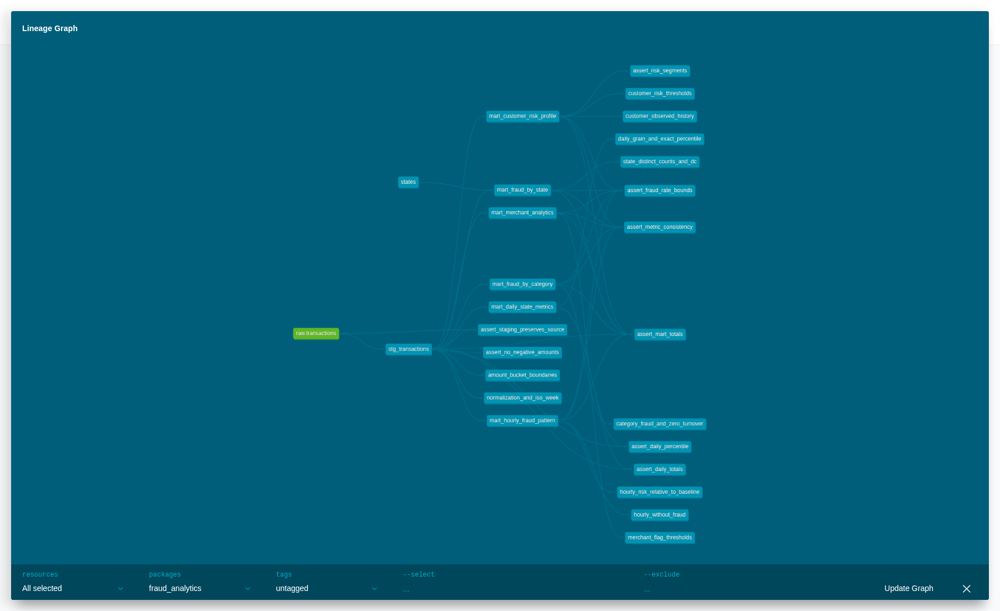
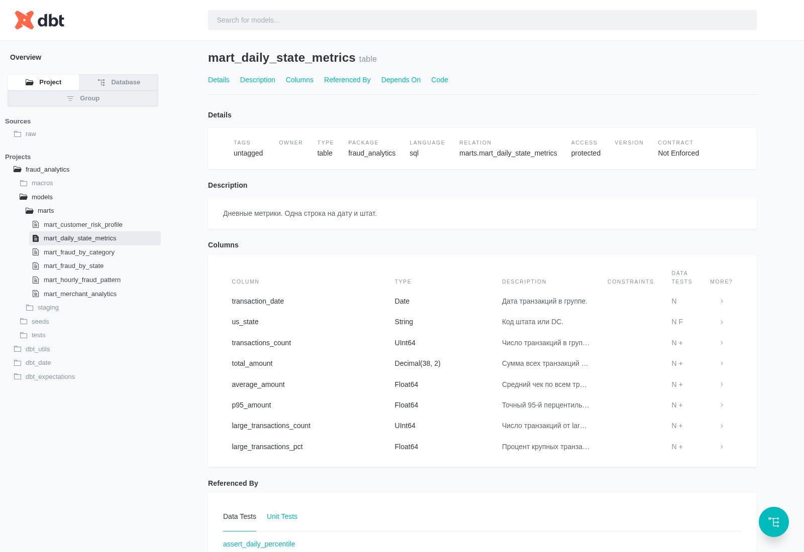

## dbt и ClickHouse

dbt-core 1.10.13, dbt-clickhouse 1.9.6.

Источник: train.csv, 786431 строк. Слой raw находится в transactions_db.transactions.

## Витрины

| Модель | Строк |
|---|---:|
| mart_daily_state_metrics | 21386 |
| mart_fraud_by_category | 14 |
| mart_fraud_by_state | 51 |
| mart_customer_risk_profile | 965 |
| mart_hourly_fraud_pattern | 168 |
| mart_merchant_analytics | 693 |

## Проверки

Прошли 188 data tests и 10 нативных unit tests. SQLFluff завершился без ошибок.

Проверены обязательные поля, уникальность ключей, допустимые значения, связи со справочником, границы метрик и сохранение количества и сумм транзакций. Все витрины сверены с отдельным расчетом по CSV.

[Лог dbt test](https://github.com/zorkina/fraud-clickhouse/blob/hw4-dbt/dbt/evidence/dbt-test.log) · [Результаты тестов](https://github.com/zorkina/fraud-clickhouse/blob/hw4-dbt/dbt/evidence/dbt_test_results.json) · [Лог SQLFluff](https://github.com/zorkina/fraud-clickhouse/blob/hw4-dbt/dbt/evidence/sqlfluff.log)

## Документация





## Запуск

```bash
bash dbt/start.sh /полный/путь/к/teta-ml-1-2025.zip
```

В корне добавлены Makefile и .pre-commit-config.yaml. Конфигурация линтера находится в dbt/.sqlfluff. Исходный CSV в PR не включен.
